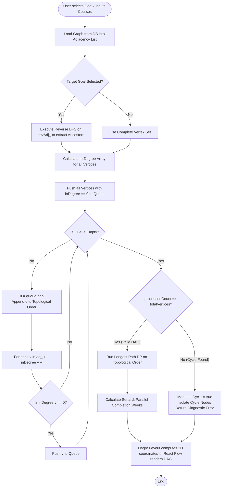
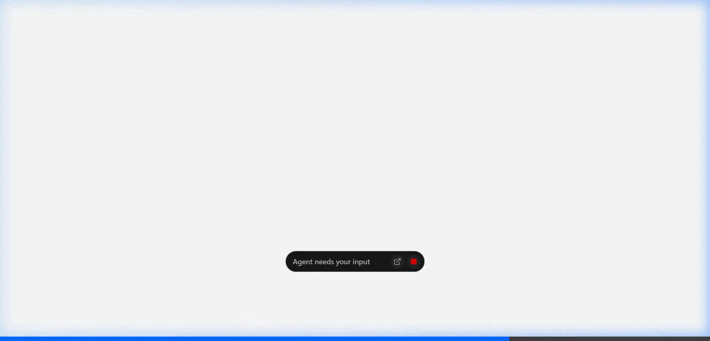

# Mini Project Report: PathPilot — Personalised Learning Path Planner
**Course**: Data Structures and Algorithms Laboratory  
**Academic Year**: 2025–2026 | **Project Type**: Algorithmic Full-Stack System

---

## 1. Project Title, Group Members & Guide

### Project Title
**PathPilot: Personalised Learning Path Planner using Directed Acyclic Graphs (DAG)**

### Group Details
| S.No. | Student / Group Member Name | Roll Number | Branch / Department |
| :---: | :--- | :---: | :--- |
| 1 | **Bhoomi Kabra** | `[Your Roll Number]` | Computer Science & Engineering |
| 2 | `[Group Member 2 Name]` | `[Roll Number]` | Computer Science & Engineering |
| 3 | `[Group Member 3 Name]` | `[Roll Number]` | Computer Science & Engineering |

### Project Guide
- **Guide Name**: `[Prof. / Dr. Guide Name]`
- **Designation**: `[Assistant Professor / Associate Professor]`, Department of Computer Science & Engineering

---

## 2. Problem Statement & Objectives

### Problem Statement
In modern computer science curricula and modular self-learning platforms, course catalogues contain dozens of interdependent courses. Students face several critical challenges:
1. **Curriculum Paralysis**: Not knowing which foundational subjects must be completed before attempting advanced electives (e.g., attempting *Deep Learning* without *Linear Algebra* or *Python*).
2. **Circular Dependency Traps**: Undetected cycles in academic prerequisite data ($A \to B \to C \to A$) make graduation mathematically impossible.
3. **Irrelevant Course Bloat**: When pursuing a specific target career (e.g., *Machine Learning Engineer*), students are overwhelmed by entire university catalogues rather than the minimal necessary prerequisite subgraph.
4. **Timeline Miscalculation**: Lack of bottleneck identification leads to inaccurate semester completion estimates.

### Objectives
- Model an entire curriculum of courses and prerequisites strictly as a **Directed Acyclic Graph (DAG)**.
- Implement **Cycle Detection** to guarantee prerequisite consistency and reject deadlocked schedules.
- Implement **Reverse Breadth-First Search (BFS)** to extract the minimal ancestor prerequisite subgraph for any targeted career goal.
- Implement **Kahn’s Topological Sorting Algorithm** using in-degree arrays to generate a valid sequential learning order.
- Implement **Critical Path Analysis** via Dynamic Programming over the topological order to calculate the minimum parallel time required to complete the curriculum.
- Build a native compiled **C++ Graph Algorithm Engine** interfaced with an interactive **Next.js & React Flow** visual user interface for real-time demonstration.

---

## 3. Introduction & Description of Proposed Solution

### Introduction
A prerequisite relationship between two courses represents a strict dependency constraint: if Course $A$ is a prerequisite for Course $B$, then $A$ must be mastered before $B$ can be started. Graph theory provides the exact mathematical framework needed to model, validate, and optimize these relationships.

### Proposed Solution Architecture
PathPilot separates high-level user interaction from low-level algorithmic computation:
1. **Data Layer (PostgreSQL & Prisma ORM)**: Stores course vertices (code, title, credits, category) and prerequisite edges ($u \to v$).
2. **Native C++ Graph Engine (`graph_engine.exe`)**: A high-performance, standalone C++17 binary that loads graph data into an in-memory adjacency list and executes Reverse BFS, Kahn's Topological Sort, Cycle Detection, and Longest Path Dynamic Programming in under $3\text{ ms}$.
3. **IPC Bridge (`child_process`)**: A typed Node.js pipeline streaming JSON payloads via `stdin`/`stdout` between Next.js API routes and the C++ engine.
4. **Visual Interface (`React Flow` & `Dagre`)**: Automatically computes 2D coordinates using a Sugiyama-style layered DAG layout ($rankdir = \text{LR}$) to render interactive node cards, directed smoothstep arrows, and live completion badges.

```
+-------------------------------------------------------------------------------+
|                             Next.js Full-Stack App                            |
|  [Student GUI / React Flow Canvas] <---> [Next.js API: /api/graph/analyze]    |
+---------------------------------------+---------------------------------------+
                                        | (JSON Stdin / Stdout IPC)
                                        v
+-------------------------------------------------------------------------------+
|                       Native C++ Graph Algorithm Engine                       |
|   Adjacency List  -->  Reverse BFS  -->  Kahn's TopoSort  -->  Critical Path  |
+---------------------------------------+---------------------------------------+
                                        |
                                        v
+-------------------------------------------------------------------------------+
|                  Database Tier (Neon PostgreSQL + Prisma ORM)                 |
|       Courses (44 Modules)  <====== Prerequisite Edges (58 Directed Links)     |
+-------------------------------------------------------------------------------+
```

---

## 4. Data Structures & Algorithms (DSA) Used with Justification

### 1. Graph (Vertices and Directed Edges)
- **Concept**: A non-linear data structure $G = (V, E)$ where vertices represent courses and directed edges represent prerequisite dependencies.
- **Why We Use It**: Real curricula are non-linear; multiple courses can branch out into diverse electives or converge into capstone courses.
- **Benefit**: Captures one-to-many and many-to-one dependency relationships that simple arrays or trees cannot model.

### 2. Directed Acyclic Graph (DAG)
- **Concept**: A directed graph containing zero directed cycles ($v_1 \to v_2 \to \dots \to v_k \to v_1$).
- **Why We Use It**: A valid academic curriculum must be acyclic. A cycle means a course indirectly requires itself as a prerequisite, creating an unresolvable learning deadlock.
- **Benefit**: Ensures a mathematical topological ordering exists.

### 3. Adjacency List (Dual Forward & Reverse)
- **Concept**: An array of lists where vertex $u$ maintains lists of adjacent vertices. PathPilot implements:
  1. `adj_[u]`: Forward list of courses unlocked by $u$.
  2. `revAdj_[v]`: Reverse list of prerequisites required by $v$.
- **Why We Use It**: Academic graphs are **sparse** ($|E| \ll |V|^2$). For $V=44$ and $E=58$, an adjacency matrix would waste $44^2 = 1936$ cells, whereas the adjacency list uses only $44 + 58 = 102$ entries.
- **Space Complexity**: $\mathcal{O}(V + E)$.

### 4. Breadth-First Search (BFS) & Queue
- **Concept**: Level-by-level graph exploration using a First-In, First-Out (FIFO) `std::queue`.
- **How We Use It**: **Reverse BFS Subgraph Extraction**: Starting from goal milestone courses (e.g., *Natural Language Processing*), BFS traverses backwards through `revAdj_` to collect all ancestor prerequisites while filtering out unrelated catalogue modules.
- **Time Complexity**: $\mathcal{O}(V + E)$.

### 5. Topological Sorting (Kahn’s In-Degree Algorithm)
- **Concept**: Linear ordering of vertices such that for every directed edge $u \to v$, vertex $u$ appears before $v$.
- **Why We Use Kahn's over DFS**: Kahn’s algorithm uses an explicit in-degree array (`inDegree_`) and a FIFO queue. Foundational courses (in-degree $= 0$) are processed first; as courses are completed, dependent in-degrees decrement. This directly simulates real-world course unlocks.
- **Time Complexity**: $\mathcal{O}(V + E)$.

### 6. Cycle Detection
- **Concept**: In Kahn's algorithm, if the total count of dequeued courses is strictly less than the total number of vertices $|V|$, a cycle exists.
- **Why We Use It**: It detects circular dependencies automatically during sorting without requiring extra coloring passes. All vertices with remaining in-degree $> 0$ are isolated and reported as cycle participants.
- **Benefit**: Eliminates corrupted curriculum entries immediately.

### 7. Dynamic Programming on DAG (Critical Path Method)
- **Concept**: Finding the longest path in a weighted DAG by relaxing edge weights along the topological order.
- **Why We Use It**: Course `estimatedHours` represent vertex weights. The longest chain represents the non-parallelizable bottleneck duration of the degree.
- **Time Complexity**: $\mathcal{O}(V + E)$.

### 8. Stack and Queue (Primitive Data Structures)
- **Queue (`std::queue`)**: Enforces fair FIFO processing in Kahn's algorithm and BFS.
- **Hash Maps (`std::unordered_map`)**: Provides $\mathcal{O}(1)$ average-time lookup for Course Code to Vertex Index mapping.

### Summary Table of Complexity
| Data Structure / Algorithm | Purpose in PathPilot | Time Complexity | Space Complexity |
| :--- | :--- | :---: | :---: |
| **Adjacency List (`adj_`, `revAdj_`)** | Graph storage in RAM | $\mathcal{O}(1)$ edge lookup | $\mathcal{O}(V + E)$ |
| **Reverse BFS Traversal** | Goal prerequisite subgraph extraction | $\mathcal{O}(V + E)$ | $\mathcal{O}(V)$ |
| **Kahn's Topological Sort** | Compute valid learning sequence | $\mathcal{O}(V + E)$ | $\mathcal{O}(V)$ |
| **Cycle Detection** | Identify deadlock dependencies | $\mathcal{O}(V + E)$ | $\mathcal{O}(V)$ |
| **Critical Path DP** | Longest path time bottleneck | $\mathcal{O}(V + E)$ | $\mathcal{O}(V)$ |

---

## 5. Flowcharts & Algorithms / Pseudocode

### 5.a System Execution Flowchart



---

### 5.b Core Pseudocode

#### Algorithm 1: Goal Subgraph Extraction via Reverse BFS
```text
Algorithm ReverseBFS_Subgraph(targetIndices, revAdj, vertices):
    Input: targetIndices (list of goal courses), revAdj (reverse adjacency list)
    Output: subgraph G' containing only reachable ancestors

    visited = empty hash set
    queue = empty FIFO queue

    for each target in targetIndices:
        visited.add(target)
        queue.push(target)

    while queue is not empty:
        curr = queue.pop()
        for each prereq in revAdj[curr]:
            if prereq not in visited:
                visited.add(prereq)
                queue.push(prereq)

    G' = constructInducedSubgraph(vertices, visited)
    return G'
```

#### Algorithm 2: Kahn's Algorithm for Topological Sort & Cycle Detection
```text
Algorithm Kahns_Topological_Sort(V, adj, inDegree):
    Input: Vertices V, Adjacency List adj, In-Degree array
    Output: Pair <learningOrder, hasCycle>

    queue = empty FIFO queue
    order = empty list

    for i from 0 to |V| - 1:
        if inDegree[i] == 0:
            queue.push(i)

    while queue is not empty:
        u = queue.pop()
        order.append(V[u])

        for each neighbor v in adj[u]:
            inDegree[v] = inDegree[v] - 1
            if inDegree[v] == 0:
                queue.push(v)

    if length(order) < |V|:
        return <order, hasCycle = true>
    else:
        return <order, hasCycle = false>
```

#### Algorithm 3: Critical Path Calculation via Dynamic Programming
```text
Algorithm Compute_Critical_Path(topoOrder, adj, vertices, weeklyHours):
    Input: topoOrder (from Kahn's), adj, vertices with estimatedHours, weeklyHours
    Output: Critical Path list and estimated weeks

    distTo = array of size |V| initialized to estimatedHours of each vertex
    parent = array of size |V| initialized to -1

    for each u in topoOrder:
        for each v in adj[u]:
            weight = vertices[v].estimatedHours
            if distTo[u] + weight > distTo[v]:
                distTo[v] = distTo[u] + weight
                parent[v] = u

    maxEndNode = index with maximum value in distTo
    criticalPath = reconstructPathFromParent(parent, maxEndNode)
    parallelWeeks = ceil(distTo[maxEndNode] / weeklyHours)
    return <criticalPath, distTo[maxEndNode], parallelWeeks>
```

---

## 6. Implementation Details & Relevant Code Snippets

The core engine is implemented in standard **C++17** (`cpp/src/GraphEngine.cpp`):

### 1. In-Memory Graph Representation
```cpp
// cpp/include/GraphEngine.h
class DirectedGraph {
private:
    std::vector<CourseVertex> vertices_;
    std::vector<PrereqEdge> edges_;
    std::unordered_map<std::string, int> codeToIndex_;
    std::vector<std::vector<int>> adj_;    // Forward:  u -> v (u unlocks v)
    std::vector<std::vector<int>> revAdj_; // Reverse:  v -> u (v requires u)
    std::vector<int> inDegree_;            // In-degree array for Kahn's algorithm

public:
    int addVertex(const CourseVertex& vertex);
    bool addEdge(int u, int v, const std::string& fromCode, const std::string& toCode);
    std::pair<std::vector<CourseVertex>, bool> computeTopologicalSort(...) const;
    StudyTimeEstimates computeCriticalPath(...) const;
};
```

### 2. Kahn's Topological Sort Implementation
```cpp
// cpp/src/GraphEngine.cpp
std::pair<std::vector<CourseVertex>, bool> DirectedGraph::computeTopologicalSort(
    std::vector<std::string>& outCycleNodes,
    std::vector<std::string>& outBlockedNodes
) const {
    int n = static_cast<int>(vertices_.size());
    std::vector<int> curInDegree = inDegree_;
    std::queue<int> q;

    for (int i = 0; i < n; ++i) {
        if (curInDegree[i] == 0) q.push(i);
    }

    std::vector<CourseVertex> order;
    while (!q.empty()) {
        int u = q.front();
        q.pop();
        order.push_back(vertices_[u]);

        for (int v : adj_[u]) {
            curInDegree[v]--;
            if (curInDegree[v] == 0) q.push(v);
        }
    }

    bool hasCycle = (static_cast<int>(order.size()) < n);
    if (hasCycle) {
        for (int i = 0; i < n; ++i) {
            if (curInDegree[i] > 0) outCycleNodes.push_back(vertices_[i].code);
        }
    }
    return {order, hasCycle};
}
```

---

## 7. Sample Inputs, Outputs & Test Execution

### Sample 1: Input JSON Payload (Sent from Next.js to C++ Engine)
```json
{
  "operation": "goal-roadmap",
  "goal": "machine-learning-engineer",
  "weeklyStudyHours": 15,
  "courses": [
    { "code": "CS101", "title": "Programming Fundamentals", "estimatedHours": 25 },
    { "code": "MATH201", "title": "Linear Algebra & Matrices", "estimatedHours": 30 },
    { "code": "CS301", "title": "Machine Learning Foundations", "estimatedHours": 45 },
    { "code": "CS302", "title": "Deep Learning & Neural Networks", "estimatedHours": 50 }
  ],
  "prerequisites": [
    { "from": "CS101", "to": "CS301" },
    { "from": "MATH201", "to": "CS301" },
    { "from": "CS301", "to": "CS302" }
  ]
}
```

### Sample 2: Output JSON Payload (Returned by C++ Engine)
```json
{
  "success": true,
  "hasCycle": false,
  "vertexCount": 4,
  "edgeCount": 3,
  "learningOrder": [
    { "code": "CS101", "title": "Programming Fundamentals", "level": 0 },
    { "code": "MATH201", "title": "Linear Algebra & Matrices", "level": 0 },
    { "code": "CS301", "title": "Machine Learning Foundations", "level": 1 },
    { "code": "CS302", "title": "Deep Learning & Neural Networks", "level": 2 }
  ],
  "criticalPathCodes": ["MATH201", "CS301", "CS302"],
  "studyTimeEstimates": {
    "totalStudyHours": 150,
    "criticalPathHours": 125,
    "weeklyStudyHours": 15,
    "parallelEstimatedWeeks": 9,
    "serialEstimatedWeeks": 10
  }
}
```

### Test Suite Execution Output
PathPilot features an automated test harness validating algorithmic accuracy:

1. **C++ Unit Tests (`npm run cpp:test`)**:
```text
[TEST 1] Running: test1_SimpleValidGraph... PASSED
[TEST 2] Running: test2_MultiplePrerequisites... PASSED
[TEST 3] Running: test3_IndependentCourses... PASSED
[TEST 4] Running: test4_DirectedCycle... PASSED
[TEST 5] Running: test5_DisconnectedGraph... PASSED
[TEST 6] Running: test6_GoalBasedPrerequisiteExtraction... PASSED
[TEST 7] Running: test7_SharedPrerequisites... PASSED
[TEST 8] Running: test8_EmptyGraph... PASSED
[TEST 9] Running: test9_InvalidInput... PASSED
[TEST 10] Running: test10_StudyTimeEstimation... PASSED
[TEST 11] Running: test11_StepByStepTrace... PASSED
[TEST 12] Running: test12_EdmondsKarpMaxFlowMinCut... PASSED
========================================
Results: 12 / 12 passed.
========================================
```

2. **Next.js <-> C++ Integration Tests (`npm run test:integration`)**:
```text
[INTEGRATION TEST 1] Full catalogue graph analysis through C++ engine... PASSED
[INTEGRATION TEST 2] ML goal prerequisite extraction and topological order... PASSED
[INTEGRATION TEST 3] Full-Stack goal prerequisite extraction and critical path... PASSED
[INTEGRATION TEST 4] DSA goal prerequisite extraction and critical path... PASSED
[INTEGRATION TEST 5] Student progress overlay and next recommendations... PASSED
[INTEGRATION TEST 6] React Flow node positions and directed edges generation... PASSED
[INTEGRATION TEST 7] Prerequisite edges direction and matching endpoints... PASSED
[INTEGRATION TEST 8] Prerequisite Ancestor Traversal BFS correctness... PASSED
==================================================
Integration Test Results: 8 / 8 passed
==================================================
```

### Screenshots Demonstrating Project Working

#### Figure 1: Split-Screen Authentication & Quick Student Demo

*Description: Clean split-screen authentication interface featuring university branding on the left and secure sign-in / registration on the right. Includes a one-click "Quick Student Demo" button for instant evaluation during viva demonstrations.*

#### Figure 2: Interactive Directed Acyclic Graph (DAG) Roadmap Canvas

*Description: The primary visual interface rendered by React Flow and styled with Dagre layered layout (Left-to-Right). Course vertices are displayed with category color bars, module codes, hours, and status badges. Prerequisite relationships are indicated by directed arrows computed from topological layers.*

#### Figure 3: Interactive Kahn's Algorithm Inspector & Queue Stepper

*Description: Live educational visualizer demonstrating Kahn's algorithm step-by-step. Displays the instantaneous queue state, current in-degree values for all courses, and active edge traversals.*

#### Figure 4: Student Knowledge State & Progress Tracker

*Description: Real-time progress tracker reflecting completed courses, unlocked subjects ready to start, and locked modules pending prerequisite completion.*

---

## 8. Conclusion & Real-World Applications

### Conclusion
The PathPilot project successfully demonstrates how fundamental **Data Structures and Algorithms** solve real academic planning problems. By modeling the curriculum as a **Directed Acyclic Graph**, the system:
1. Employs **Kahn's Algorithm** to enforce valid, step-by-step linear learning orders without deadlocks.
2. Uses **Reverse BFS** to prune a 44-course catalogue down to the exact prerequisite tree needed for a student's chosen career goal.
3. Applies **Dynamic Programming on DAGs** to calculate critical paths and estimate realistic completion dates.
4. Achieves sub-millisecond algorithmic execution ($< 3\text{ ms}$) by implementing the core engine in compiled native **C++17**, connected via high-speed IPC to a modern **Next.js React Flow** user interface.

### Real-World Applications
- **University Degree Audit & Advisory Systems**: Automates academic advisor evaluations, prevents invalid course enrollments, and verifies prerequisite compliance before semester registration.
- **Online Learning Platforms (Coursera, edX, Khan Academy)**: Dynamically generates custom learning roadmaps for users based on target industry roles.
- **Corporate Skill Training & Workforce Upskilling**: Helps companies map out prerequisite training paths for employees transitioning from traditional software engineering to Machine Learning or Cloud DevOps.
- **Pedagogical Algorithm Demonstrator**: Serves as a live classroom teaching tool for graph traversal, in-degree processing, and topological sorting.
