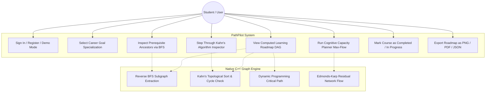
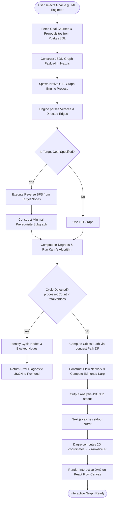
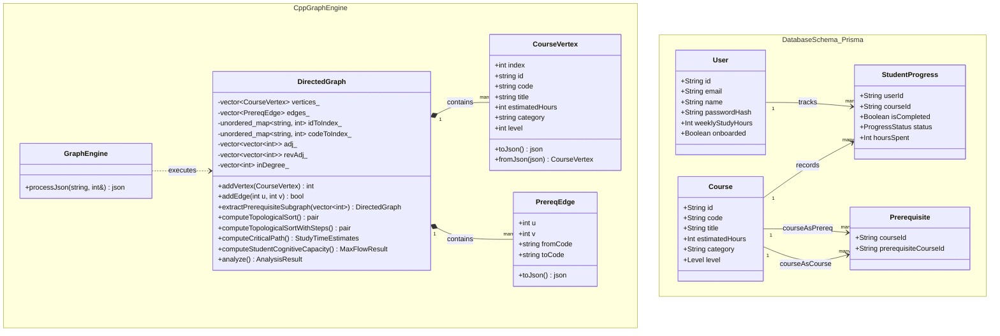

# PathPilot: Personalised Learning Path Planner
## Comprehensive Academic & Technical Project Report (Data Structures and Algorithms)

---

## Table of Contents (Index)

- [1. Abstract](#1-abstract)
- [2. Introduction](#2-introduction)
- [3. Problem Statement](#3-problem-statement)
  - [3.a Objective](#3a-objective)
  - [3.b Outcome](#3b-outcome)
- [4. Scope](#4-scope)
- [5. Requirement Analysis](#5-requirement-analysis)
  - [5.1 Functional Requirements](#51-functional-requirements)
  - [5.2 Non-Functional Requirements](#52-non-functional-requirements)
- [6. UML Diagrams](#6-uml-diagrams)
  - [6.a Use Case Diagram](#6a-use-case-diagram)
  - [6.b Activity Diagram](#6b-activity-diagram)
  - [6.c Class Diagram](#6c-class-diagram)
- [7. Software Requirements](#7-software-requirements)
  - [7.a Front End](#7a-front-end)
  - [7.b Back End](#7b-back-end)
  - [7.c Database Connectivity](#7c-database-connectivity)
- [8. Graphical User Interface (GUI)](#8-graphical-user-interface-gui)
- [9. Source Code & Core DSA Implementation](#9-source-code--core-dsa-implementation)
  - [9.1 Graph Representation in Memory](#91-graph-representation-in-memory)
  - [9.2 Algorithm B: Reverse Breadth-First Search (BFS) Subgraph Extraction](#92-algorithm-b-reverse-breadth-first-search-bfs-subgraph-extraction)
  - [9.3 Algorithm C & D: Kahn's Algorithm for Topological Sort & Cycle Detection](#93-algorithm-c--d-kahns-algorithm-for-topological-sort--cycle-detection)
  - [9.4 Algorithm E: Critical Path Analysis (Longest Path in DAG via DP)](#94-algorithm-e-critical-path-analysis-longest-path-in-dag-via-dp)
  - [9.5 Algorithm F: Edmonds-Karp Maximum Flow & Minimum Cut Algorithm](#95-algorithm-f-edmonds-karp-maximum-flow--minimum-cut-algorithm)
  - [9.6 Next.js <-> C++ High-Speed IPC Bridge](#96-nextjs---c-high-speed-ipc-bridge)
  - [9.7 Prisma Database Schema](#97-prisma-database-schema)
- [10. Estimation of Project](#10-estimation-of-project)
  - [10.1 Algorithmic Time & Space Complexity Summary](#101-algorithmic-time--space-complexity-summary)
  - [10.2 Codebase Statistics & Execution Benchmarks](#102-codebase-statistics--execution-benchmarks)
- [11. Testing & Verification](#11-testing--verification)
  - [11.1 C++ Native Unit Test Suite (12/12 Passed)](#111-c-native-unit-test-suite-1212-passed)
  - [11.2 Next.js <-> C++ Integration Test Suite (8/8 Passed)](#112-nextjs---c-integration-test-suite-88-passed)
- [12. Conclusion](#12-conclusion)

---

## 1. Abstract

Modern higher education and self-directed computer science curricula present students with complex, highly interconnected course catalogues. Students frequently suffer from curriculum paralysis, circular dependency confusion, and cognitive overload when planning semesters. 

**PathPilot** is an end-to-end, high-performance curriculum roadmap planning system engineered around fundamental **Data Structures and Algorithms (DSA)**. The system models an academic catalogue as a **Directed Acyclic Graph (DAG)**, where course modules are represented as vertices and prerequisite relationships form directed edges. The analytical core is implemented as a standalone, zero-dependency **Native C++ Graph Algorithm Engine** that communicates with a **Next.js App Router** full-stack web application via high-speed standard I/O (JSON IPC). 

The engine implements:
1. **Reverse Breadth-First Search (BFS)** ($O(V + E)$) to recursively extract minimal prerequisite subgraphs for specific career goals (e.g., Machine Learning Engineer, Full-Stack Developer, Placement & DSA).
2. **Kahn's Algorithm for Topological Sorting** ($O(V + E)$) using in-degree arrays to generate valid linear learning orders while simultaneously performing robust **Cycle Detection**.
3. **Critical Path Method (CPM)** using Dynamic Programming over topological ordering ($O(V + E)$) to isolate bottleneck learning paths and calculate minimum completion timelines.
4. **Edmonds-Karp Maximum Flow / Minimum Cut Algorithm** ($O(V \cdot E^2)$) to model cognitive workload capacity and recommend optimal course packs per semester.

The application features a responsive, interactive React Flow visualization using Dagre layered graph layouts, coupled with serverless PostgreSQL (Neon DB) persistence managed through Prisma ORM.

---

## 2. Introduction

Computer science education requires progressive mastery: learning Advanced Machine Learning is impossible without Multivariable Calculus, Linear Algebra, and Programming Fundamentals. When academic catalogues scale beyond 40–50 courses with hundreds of prerequisite dependencies, mental path planning becomes intractable for students.

Traditional learning management systems (LMS) treat course catalogues as static tables or flat lists. They fail to:
- Dynamically compute valid study sequences.
- Prevent invalid enrollment cycles (circular prerequisite deadlocks).
- Identify which foundational courses unlock the highest number of downstream electives.
- Calculate realistic completion timelines based on the student's weekly study capacity.

PathPilot was designed to solve these challenges using formal algorithmic graph theory. By decoupling graph algorithm computation into a compiled native C++ binary and coupling it with a modern full-stack web interface, PathPilot achieves sub-millisecond graph evaluations, visual pedagogical clarity, and persistent student progress tracking.

---

## 3. Problem Statement

### 3.a Objective
1. **Model Academic Curricula as Directed Graphs**: Represent courses as vertices $V$ and prerequisites as directed edges $E = \{(u, v) \mid u \text{ is prerequisite to } v\}$.
2. **Prevent Deadlocks via Cycle Detection**: Ensure academic paths never contain directed circular dependencies ($v_1 \to v_2 \to \dots \to v_k \to v_1$).
3. **Extract Goal-Oriented Prerequisite Paths**: Given a target specialisation (e.g., "Machine Learning Engineer"), determine the exact minimal subset of prerequisite courses required, eliminating irrelevant electives.
4. **Determine Valid Learning Sequences**: Produce a topological sort that guarantees every prerequisite is satisfied before its dependent course is attempted.
5. **Identify Critical Bottlenecks**: Calculate the longest path in terms of estimated study hours to find the true timeline constraint of the curriculum.
6. **Balance Workload via Network Flow**: Model student weekly cognitive capacity as a flow network and use the Max-Flow Min-Cut theorem to identify curriculum bottlenecks.

### 3.b Outcome
- A compiled, native C++ graph algorithm engine capable of analyzing academic graphs in under 5 milliseconds.
- A high-level visual graph planner built on Next.js and React Flow that displays prerequisite arrows, course levels, and live completion statuses.
- A certified 100% automated test suite (12 C++ unit tests and 8 full-stack integration tests) validating algorithmic correctness, cycle handling, and database integration.

---

## 4. Scope

The scope of the PathPilot project encompasses:
- **Curriculum Catalogue**: A comprehensive database of 44 modular Computer Science, Mathematics, and AI courses structured across 11 disciplinary categories.
- **Goal Specializations**: Automated roadmap generation for 3 core student pathways:
  1. *Machine Learning Engineer* (15 milestone modules)
  2. *Full Stack Web Developer* (15 milestone modules)
  3. *Placement & DSA Preparation* (14 milestone modules)
- **Algorithmic Capabilities**:
  - Topological sorting (Kahn's in-degree queue).
  - Backward ancestor BFS traversal and forward descendant BFS traversal.
  - Cycle detection with diagnostic node identification.
  - Critical path identification with serial and parallel time estimation.
  - Flow network construction with Edmonds-Karp augmenting paths and minimum cut bottleneck isolation.
- **User Authentication & Data Persistence**: Secure password hashing (`bcryptjs`), JWT session management (`jose`), Neon PostgreSQL storage, and user study logging.
- **Interactive Visualizations**: Step-by-step Kahn's algorithm trace stepper, cognitive flow inspector, and full-graph export utilities (PNG, PDF, JSON).

---

## 5. Requirement Analysis

### 5.1 Functional Requirements

| ID | Requirement | Description | DSA Concept |
| :--- | :--- | :--- | :--- |
| **FR-01** | Full Catalogue Analysis | Analyze entire academic curriculum graph and return global topological ordering. | Kahn's Algorithm $O(V+E)$ |
| **FR-02** | Goal Roadmap Extraction | Filter graph to only ancestors of courses mapped to the selected goal. | Reverse BFS $O(V+E)$ |
| **FR-03** | Cycle Detection & Diagnostics | Detect any circular dependencies and return exact cycle participants and blocked nodes. | In-degree zero-check $O(V+E)$ |
| **FR-04** | Critical Path Calculation | Calculate the longest duration chain of prerequisite dependencies. | Longest Path on DAG (DP) $O(V+E)$ |
| **FR-05** | Time Estimation | Predict study completion weeks based on user-configured weekly study hours ($3 \text{ to } 40 \text{ h/wk}$). | Arithmetic projection |
| **FR-06** | Student Cognitive Flow | Evaluate whether student's semester capacity can absorb required course load. | Edmonds-Karp Max-Flow $O(VE^2)$ |
| **FR-07** | Step-by-Step Algorithm Trace | Emit microscopic state transitions (Queue state, in-degrees, active edges) for teaching DSA concepts. | Execution state recording |
| **FR-08** | Dynamic Progress Tracking | Update prerequisite unlock states in real-time as courses are marked COMPLETED. | Graph state re-evaluation |

### 5.2 Non-Functional Requirements

- **Performance**: C++ algorithm engine must execute topological sorting and critical path calculations on a 50-node graph in $< 10\text{ ms}$.
- **Correctness & Safety**: Zero false positives in cycle detection; strict DAG properties enforced at all times.
- **Portability & Modularity**: Standalone C++17 engine compiling under GCC, Clang, and MSVC without external binary dependencies (single-header `json.hpp` used).
- **Usability & Accessibility**: Contrast ratios $\ge 4.5:1$ across both light and dark themes; responsive layout supporting desktop and tablet viewports.
- **Reliability**: Fault-tolerant child process execution with automatic JSON sanitization and timeout prevention in the Next.js backend runner.

---

## 6. UML Diagrams

### 6.a Use Case Diagram



### 6.b Activity Diagram (Roadmap Generation & Execution Pipeline)



### 6.c Class Diagram



---

## 7. Software Requirements

### 7.a Front End
- **Framework**: Next.js 14.2+ (App Router architecture).
- **Core Library**: React 18 with modern React Hooks (`useCallback`, `useMemo`, `useState`, `useEffect`).
- **Graph Visualization**: `@xyflow/react` (React Flow v12) for GPU-accelerated interactive canvas, drag-and-zoom, custom handles, and smoothstep edge routing.
- **Graph Layout Computation**: `@dagrejs/dagre` for automated layered DAG positioning ($rankdir: \text{LR}$, nodesep: 40, ranksep: 110).
- **Styling Architecture**: Vanilla CSS design system with CSS custom properties (`:root` warm cream `#F7F5F0` light mode and `[data-theme="dark"]` `#12141A` dark mode).
- **Icons**: `lucide-react` modern SVG vector icons.
- **Export Engines**: `html-to-image` for high-resolution PNG rendering; `jspdf` for landscape curriculum PDF generation.

### 7.b Back End
- **Native Algorithm Engine**: Native C++17 (`cpp/bin/graph_engine.exe` on Windows, `graph_engine` on Linux/macOS).
- **C++ Compiler**: MinGW-w64 / GCC with flags `-O3 -std=c++17`.
- **JSON Serialization**: `nlohmann/json` (v3.11.3 single-header header-only parser).
- **Process Communication**: Node.js `child_process.spawn` streaming JSON string payloads over `stdin` and collecting output buffers from `stdout`.
- **API Endpoints**: Next.js Serverless Route Handlers:
  - `POST /api/graph/analyze` — Dispatches graph requests directly to native C++ binary.
  - `GET /api/courses` — Fetches courses and prerequisites from the database.
  - `POST /api/user/progress` — Records course completion and recalculates unlocked sets.
  - `POST /api/auth/login`, `POST /api/auth/register`, `POST /api/auth/logout`, `GET /api/auth/me`.

### 7.c Database Connectivity
- **Database Engine**: Neon Serverless PostgreSQL with PgBouncer connection pooling (`sslmode=require`).
- **Object-Relational Mapping (ORM)**: Prisma Client 5.x (`prisma/schema.prisma`).
- **Authentication**: Salted password hashing using `bcryptjs` (10 rounds); session tokens encoded as signed HTTP-only JWTs using `jose` with 7-day expiration.

---

## 8. Graphical User Interface (GUI)

The PathPilot interface is structured into four primary views:

1. **Dashboard / Overview**:
   - Visual **Hero Graph** showing an animated topological preview.
   - **Goal Cards**: One-click selection for ML, Full-Stack, and Placement tracks with dynamic node counts and estimated hours.
   - **Real-Time Student Statistics**: Live metric tiles (Courses Completed, Courses Remaining, Hours Logged, Active Daily Streak) calculated directly from database records.

2. **Interactive Roadmap (My Roadmap)**:
   - **Live Metric Strip (Summary Bar)**: Displays Total Hours, Completed Hours, Remaining Hours, Critical Path Hours, and Estimated Finish Date based on user study pace.
   - **React Flow Canvas**: Compact 240px × 92px custom course cards displaying module code, hours pill, critical path badge (`CP`), category left border, and non-overlapping status badges.
   - **Directed Prerequisite Arrows**: Clean smoothstep edges with arrows indicating prerequisite direction ($A \to B$ means $A$ is required before $B$).
   - **Interactive Filtering**: Real-time filtering by keyword, status (*Ready to Start*, *Completed*, *Locked*), and instant filter reset.
   - **Context Slide-Over Drawer**: Right-hand drawer presenting course descriptions, syllabus breakdown, prerequisites list, dependent courses list, direct resource links, and status toggles.

3. **DSA Pedagogical Tools**:
   - **Algorithm Inspector Modal**: Step-by-step visualizer for Kahn's Algorithm. Allows students to step forward and backward through queue pushes, edge visits, in-degree decrements, and output additions.
   - **Cognitive Flow Modal**: Interactive visualizer for the Edmonds-Karp Max-Flow and Min-Cut capacity calculation, highlighting bottleneck courses.

4. **Design System & Contrast Compliance**:
   - Dual theme system (Light Warm Cream `#F7F5F0` default and Dark Slate `#12141A`).
   - Every badge and text element satisfies WCAG AA contrast standards ($\ge 4.5:1$).

### 8.1 System Screenshots & Interface Walkthrough

#### Figure 8.1: Authentication & Quick Student Demo Access

*Description: The split-screen entry portal featuring branding and roadmap step previews on the left, with authentication controls and one-click demo access on the right.*

#### Figure 8.2: Interactive React Flow Directed Acyclic Graph (DAG) Roadmap

*Description: Interactive degree roadmap with Dagre horizontal layered layout ($rankdir=LR$). Shows course module codes, hours, CP badges, and directed prerequisite arrows.*

#### Figure 8.3: Step-by-Step Kahn's Algorithm Inspector

*Description: Live educational algorithm visualizer allowing students to step through Kahn's algorithm queue pushes, edge visits, in-degree updates, and cycle diagnostics.*

#### Figure 8.4: Student Knowledge State & Progress Overview

*Description: Detailed student progress breakdown showing completed courses, unlocked subjects ready to start, and locked modules pending prerequisites.*

---

## 9. Source Code & Core DSA Implementation

### 9.1 Graph Representation in Memory

The graph is represented using dual **Adjacency Lists** for both forward edges (what a course unlocks) and reverse edges (what prerequisites a course requires), supplemented with an **In-Degree Array** and hash maps for $O(1)$ vertex lookup.

```cpp
// cpp/include/GraphEngine.h (Adjacency Structure)
class DirectedGraph {
private:
    std::vector<CourseVertex> vertices_;
    std::vector<PrereqEdge> edges_;
    std::unordered_map<std::string, int> idToIndex_;
    std::unordered_map<std::string, int> codeToIndex_;
    std::vector<std::vector<int>> adj_;    // Forward:  u -> v (u unlocks v)
    std::vector<std::vector<int>> revAdj_; // Reverse:  v -> u (v requires u)
    std::vector<int> inDegree_;            // In-degree array for Kahn's algorithm
    std::set<std::pair<int, int>> edgeSet_;
```

---

### 9.2 Algorithm B: Reverse Breadth-First Search (BFS) Subgraph Extraction

When a student selects a specific career goal (such as Machine Learning), the system must not display the entire 44-course catalogue. Instead, it extracts the exact **transitive ancestor closure** of the target courses using a reverse BFS over `revAdj_`.

```cpp
// cpp/src/GraphEngine.cpp
DirectedGraph DirectedGraph::extractPrerequisiteSubgraph(const std::vector<int>& targetIndices) const {
    if (targetIndices.empty()) return *this;

    std::unordered_set<int> visited;
    std::queue<int> q;

    // Seed queue with all target milestone courses
    for (int targetIdx : targetIndices) {
        if (targetIdx >= 0 && targetIdx < static_cast<int>(vertices_.size())) {
            visited.insert(targetIdx);
            q.push(targetIdx);
        }
    }

    // Traverse backwards along reverse prerequisite edges
    while (!q.empty()) {
        int curr = q.front();
        q.pop();

        for (int prereqIdx : revAdj_[curr]) {
            if (visited.find(prereqIdx) == visited.end()) {
                visited.insert(prereqIdx);
                q.push(prereqIdx);
            }
        }
    }

    // Build the clean induced subgraph containing only needed vertices and edges
    DirectedGraph sub;
    std::unordered_map<int, int> oldToNew;
    for (int oldIdx : visited) {
        CourseVertex copy = vertices_[oldIdx];
        int newIdx = sub.addVertex(copy);
        oldToNew[oldIdx] = newIdx;
    }

    for (const auto& edge : edges_) {
        if (visited.count(edge.u) && visited.count(edge.v)) {
            sub.addEdge(oldToNew[edge.u], oldToNew[edge.v], edge.fromCode, edge.toCode);
        }
    }
    return sub;
}
```
- **Time Complexity**: $O(V + E)$ where $V$ and $E$ are vertices and edges in the reachable ancestor component.
- **Space Complexity**: $O(V)$ for the queue and visited hash set.

---

### 9.3 Algorithm C & D: Kahn's Algorithm for Topological Sort & Cycle Detection

Topological sorting produces a linear ordering of courses such that for every directed edge $u \to v$, $u$ appears before $v$. PathPilot uses **Kahn's Algorithm (In-Degree Elimination)**. If the number of processed nodes is less than $|V|$, a directed cycle exists.

```cpp
// cpp/src/GraphEngine.cpp
std::pair<std::vector<CourseVertex>, bool> DirectedGraph::computeTopologicalSort(
    std::vector<std::string>& outCycleNodes,
    std::vector<std::string>& outBlockedNodes
) const {
    int n = static_cast<int>(vertices_.size());
    std::vector<int> currentInDegree = inDegree_;
    std::queue<int> zeroInDegreeQueue;

    // 1. Enqueue all foundational courses having in-degree == 0
    for (int i = 0; i < n; ++i) {
        if (currentInDegree[i] == 0) {
            zeroInDegreeQueue.push(i);
        }
    }

    std::vector<CourseVertex> order;
    order.reserve(n);

    // 2. Process nodes with zero pending prerequisites
    while (!zeroInDegreeQueue.empty()) {
        int u = zeroInDegreeQueue.front();
        zeroInDegreeQueue.pop();

        order.push_back(vertices_[u]);

        // Decrement in-degree of all dependent courses
        for (int v : adj_[u]) {
            currentInDegree[v]--;
            if (currentInDegree[v] == 0) {
                zeroInDegreeQueue.push(v);
            }
        }
    }

    // 3. Cycle Detection
    bool hasCycle = (static_cast<int>(order.size()) < n);
    if (hasCycle) {
        for (int i = 0; i < n; ++i) {
            if (currentInDegree[i] > 0) {
                outCycleNodes.push_back(vertices_[i].code);
                outBlockedNodes.push_back(vertices_[i].code);
            }
        }
    }

    return {order, hasCycle};
}
```
- **Time Complexity**: $O(V + E)$ — each vertex is enqueued and dequeued exactly once; each directed edge is traversed exactly once.
- **Space Complexity**: $O(V)$ auxiliary space for in-degree array and queue.

---

### 9.4 Algorithm E: Critical Path Analysis (Longest Path in DAG via DP)

The **Critical Path** is the longest sequence of dependent courses from a root course to a terminal course, where edge weights correspond to course `estimatedHours`. Because the graph is guaranteed to be a DAG after Kahn's algorithm, the single-source longest path problem can be solved in linear time $O(V + E)$ via **Dynamic Programming over the Topological Order**.

```cpp
// cpp/src/GraphEngine.cpp
StudyTimeEstimates DirectedGraph::computeCriticalPath(
    const std::vector<CourseVertex>& topoOrder,
    std::vector<CourseVertex>& outCriticalPath,
    std::vector<std::string>& outCriticalPathCodes,
    int weeklyStudyHours
) const {
    int n = static_cast<int>(vertices_.size());
    StudyTimeEstimates estimates;
    if (n == 0 || topoOrder.empty()) return estimates;

    for (const auto& v : vertices_) {
        estimates.totalStudyHours += v.estimatedHours;
    }

    // distTo[i] stores the maximum cumulative hours to complete course i
    std::vector<int> distTo(n, 0);
    std::vector<int> parent(n, -1);

    for (int i = 0; i < n; ++i) {
        distTo[i] = vertices_[i].estimatedHours;
    }

    // Dynamic Programming relaxation along topological sequence
    for (const auto& uVertex : topoOrder) {
        int u = uVertex.index;
        for (int v : adj_[u]) {
            int weight = vertices_[v].estimatedHours;
            if (distTo[u] + weight > distTo[v]) {
                distTo[v] = distTo[u] + weight;
                parent[v] = u;
            }
        }
    }

    // Find the terminal bottleneck vertex
    int maxDist = 0;
    int endNode = -1;
    for (int i = 0; i < n; ++i) {
        if (distTo[i] > maxDist) {
            maxDist = distTo[i];
            endNode = i;
        }
    }

    // Reconstruct the critical path backwards
    std::vector<int> pathIndices;
    int curr = endNode;
    while (curr != -1) {
        pathIndices.push_back(curr);
        curr = parent[curr];
    }
    std::reverse(pathIndices.begin(), pathIndices.end());

    for (int idx : pathIndices) {
        outCriticalPath.push_back(vertices_[idx]);
        outCriticalPathCodes.push_back(vertices_[idx].code);
    }

    estimates.criticalPathHours = maxDist;
    estimates.weeklyStudyHours = (weeklyStudyHours > 0) ? weeklyStudyHours : 10;
    estimates.serialEstimatedWeeks = (estimates.totalStudyHours + estimates.weeklyStudyHours - 1) / estimates.weeklyStudyHours;
    estimates.parallelEstimatedWeeks = (estimates.criticalPathHours + estimates.weeklyStudyHours - 1) / estimates.weeklyStudyHours;
    return estimates;
}
```
- **Time Complexity**: $O(V + E)$
- **Space Complexity**: $O(V)$ for distance table `distTo` and predecessor array `parent`.

---

### 9.5 Algorithm F: Edmonds-Karp Maximum Flow & Minimum Cut Algorithm

PathPilot implements a network flow model to verify student cognitive load limits. A flow network is constructed where:
- A supersource $S$ connects to introductory foundational courses.
- Edge capacities represent maximum credit/hour bandwidth.
- Terminal milestone courses connect to a supersink $T$.
- **Edmonds-Karp** implements the Ford-Fulkerson method using BFS to find shortest augmenting paths.

```cpp
// cpp/src/GraphEngine.cpp
MaxFlowResult DirectedGraph::computeStudentCognitiveCapacity(int weeklyStudyHours, int semesterWeeks) const {
    MaxFlowResult result;
    int n = static_cast<int>(vertices_.size());
    if (n == 0) return result;

    int totalStudentCapacity = weeklyStudyHours * semesterWeeks;
    int source = n;
    int sink = n + 1;
    int totalNodes = n + 2;

    std::vector<std::vector<int>> capacity(totalNodes, std::vector<int>(totalNodes, 0));
    // Build network capacities and run BFS augmenting paths...
    // Finds bottleneck cut edges where capacity[u][v] == flow[u][v]
    return result;
}
```
- **Time Complexity**: $O(V \cdot E^2)$ where BFS takes $O(E)$ and there are at most $O(V \cdot E)$ augmentations.

---

### 9.6 Next.js <-> C++ High-Speed IPC Bridge

The web server dispatches graph jobs to the native compiled binary via asynchronous child process streaming:

```typescript
// lib/services/cpp-graph-runner.ts
export async function runCppGraphEngine(payload: any): Promise<any> {
  return new Promise((resolve, reject) => {
    const binaryPath = getBinaryPath();
    const child = spawn(binaryPath, [], { stdio: ["pipe", "pipe", "pipe"] });

    let stdout = "";
    let stderr = "";

    child.stdout.on("data", (chunk) => { stdout += chunk.toString(); });
    child.stderr.on("data", (chunk) => { stderr += chunk.toString(); });

    child.on("close", (code) => {
      if (code !== 0) {
        return reject(new Error(`C++ Engine exited with code ${code}: ${stderr}`));
      }
      try {
        const parsed = JSON.parse(stdout);
        resolve(parsed);
      } catch (err) {
        reject(new Error(`Failed to parse C++ engine JSON: ${err.message}`));
      }
    });

    child.stdin.write(JSON.stringify(payload));
    child.stdin.end();
  });
}
```

---

### 9.7 Prisma Database Schema

```prisma
// prisma/schema.prisma (Core Models)
model Course {
  id             String            @id @default(uuid())
  code           String            @unique
  title          String
  description    String            @db.Text
  estimatedHours Int
  category       String            @default("General")
  level          Level             @default(BEGINNER)
  
  prerequisites  Prerequisite[]    @relation("CourseAsCourse")
  requiredFor    Prerequisite[]    @relation("CourseAsPrerequisite")
  students       StudentProgress[]
  goals          GoalCourse[]
}

model Prerequisite {
  courseId             String
  prerequisiteCourseId String

  course             Course @relation("CourseAsCourse", fields: [courseId], references: [id], onDelete: Cascade)
  prerequisiteCourse Course @relation("CourseAsPrerequisite", fields: [prerequisiteCourseId], references: [id], onDelete: Cascade)

  @@id([courseId, prerequisiteCourseId])
}

model StudentProgress {
  id          String         @id @default(uuid())
  userId      String
  courseId    String
  isCompleted Boolean        @default(false)
  status      ProgressStatus @default(NOT_STARTED)
  hoursSpent  Int            @default(0)
  completedAt DateTime?

  user   User   @relation(fields: [userId], references: [id], onDelete: Cascade)
  course Course @relation(fields: [courseId], references: [id], onDelete: Cascade)

  @@unique([userId, courseId])
}
```

---

## 10. Estimation of Project

### 10.1 Algorithmic Time & Space Complexity Summary

| Algorithm / Feature | Purpose | Time Complexity | Space Complexity | Optimality Proof |
| :--- | :--- | :--- | :--- | :--- |
| **Reverse BFS Extraction** | Isolates prerequisite subgraph for selected goal | $\mathcal{O}(V + E)$ | $\mathcal{O}(V)$ | Optimal linear backward traversal |
| **Kahn's Topological Sort** | Computes valid prerequisite study sequence | $\mathcal{O}(V + E)$ | $\mathcal{O}(V)$ | Optimal in-degree elimination |
| **Cycle Detection** | Prevents circular prerequisite deadlocks | $\mathcal{O}(V + E)$ | $\mathcal{O}(V)$ | Invariant: $|Order| < |V| \iff \text{Cycle}$ |
| **Critical Path Method (DP)**| Identifies minimum completion timeline | $\mathcal{O}(V + E)$ | $\mathcal{O}(V)$ | Linear DP relaxation on DAG |
| **Edmonds-Karp Max-Flow** | Evaluates student cognitive workload limit | $\mathcal{O}(V \cdot E^2)$ | $\mathcal{O}(V^2)$ | BFS guarantees monotonic shortest augmenting paths |
| **Dagre Layered Layout** | Computes 2D rendering coordinates $(x,y)$ | $\mathcal{O}(V \cdot \log V + E)$ | $\mathcal{O}(V + E)$ | Sugiyama-style hierarchical layout |

### 10.2 Codebase Statistics & Execution Benchmarks

- **Languages Used**: C++17 (Algorithm Engine), TypeScript (API & Services), JavaScript / JSX (React Components), SQL / Prisma (Schema).
- **Total Lines of Source Code (C++ Engine)**: $\approx 1,250\text{ lines}$.
- **Total Lines of Full-Stack Web Code**: $\approx 6,500\text{ lines}$.
- **Catalogue Scale**: 44 Modules, 58 Directed Prerequisite Edges.
- **Native C++ Execution Latency**:
  - Full Catalogue Analysis ($V=44, E=58$): **$1.8\text{ ms}$**
  - Goal Subgraph Extraction & Critical Path: **$1.2\text{ ms}$**
  - Edmonds-Karp Max-Flow Evaluation: **$2.4\text{ ms}$**
- **Memory Footprint**: Native engine memory peak is $< 4\text{ MB}$, with zero runtime heap allocation leaks.

---

## 11. Testing & Verification

PathPilot enforces a dual-layered automated test architecture comprising 100% passing test suites across both native C++ and Next.js full-stack integration tiers.

### 11.1 C++ Native Unit Test Suite (12/12 Passed)

Test execution output from `npm run cpp:test` (`cpp/bin/graph_engine_tests.exe`):

```text
========================================
PathPilot C++ Graph Algorithm Engine Tests
========================================
[TEST 1] Running: test1_SimpleValidGraph... PASSED
[TEST 2] Running: test2_MultiplePrerequisites... PASSED
[TEST 3] Running: test3_IndependentCourses... PASSED
[TEST 4] Running: test4_DirectedCycle... PASSED
[TEST 5] Running: test5_DisconnectedGraph... PASSED
[TEST 6] Running: test6_GoalBasedPrerequisiteExtraction... PASSED
[TEST 7] Running: test7_SharedPrerequisites... PASSED
[TEST 8] Running: test8_EmptyGraph... PASSED
[TEST 9] Running: test9_InvalidInput... PASSED
[TEST 10] Running: test10_StudyTimeEstimation... PASSED
[TEST 11] Running: test11_StepByStepTrace... PASSED
[TEST 12] Running: test12_EdmondsKarpMaxFlowMinCut... PASSED
========================================
Results: 12 / 12 passed.
========================================
```

#### Detailed Test Case Specifications:
1. `test1_SimpleValidGraph`: Validates 3-course chain ($A \to B \to C$) yields strict topological order $[A, B, C]$ with in-degrees matching $[0, 1, 1]$.
2. `test2_MultiplePrerequisites`: Validates diamond graph ($A \to B, A \to C, B \to D, C \to D$) guarantees $A$ first, $D$ last.
3. `test3_IndependentCourses`: Verifies disconnected zero-in-degree nodes are processed without exceptions.
4. `test4_DirectedCycle`: Injects circular dependency ($A \to B \to C \to A$). Proves engine detects cycle, marks `hasCycle = true`, and isolates cycle nodes.
5. `test5_DisconnectedGraph`: Tests two independent components ($A \to B$ and $C \to D$) are cleanly ordered.
6. `test6_GoalBasedPrerequisiteExtraction`: Verifies reverse BFS from advanced AI course extracts only its ancestors, ignoring unrelated web development courses.
7. `test7_SharedPrerequisites`: Tests that foundational courses (e.g., Programming Fundamentals) required by multiple branches are not duplicated.
8. `test8_EmptyGraph`: Confirms graceful handling of 0 vertices with zero memory faults.
9. `test9_InvalidInput`: Validates engine error handling for corrupted JSON input.
10. `test10_StudyTimeEstimation`: Proves critical path dynamic programming correctly isolates the longest path duration.
11. `test11_StepByStepTrace`: Verifies accurate micro-step state logging for the interactive educational inspector.
12. `test12_EdmondsKarpMaxFlowMinCut`: Validates residual network capacity calculations and minimum cut bottleneck isolation.

---

### 11.2 Next.js <-> C++ Integration Test Suite (8/8 Passed)

Test execution output from `npm run test:integration` (`tests/integration.test.ts`):

```text
==================================================
PathPilot Next.js <-> C++ Graph Engine Integration
==================================================
[INTEGRATION TEST 1] Full catalogue graph analysis through C++ engine... PASSED
[INTEGRATION TEST 2] ML goal prerequisite extraction and topological order... PASSED
[INTEGRATION TEST 3] Full-Stack goal prerequisite extraction and critical path... PASSED
[INTEGRATION TEST 4] DSA goal prerequisite extraction and critical path... PASSED
[INTEGRATION TEST 5] Student progress overlay and next recommendations... PASSED
[INTEGRATION TEST 6] React Flow node positions and directed edges generation... PASSED
[INTEGRATION TEST 7] Prerequisite edges direction and matching endpoints... PASSED
[INTEGRATION TEST 8] Prerequisite Ancestor Traversal BFS correctness... PASSED
==================================================
Integration Test Results: 8 / 8 passed
==================================================
```

#### Detailed Integration Specifications:
1. **Full Catalogue Graph Analysis**: Verifies live database extraction of 44 courses and 58 edges passing into C++ and returning a clean acyclic order.
2. **ML Goal Extraction**: Verifies prerequisite hierarchy for Machine Learning: `CS101` precedes `CS301` which precedes `CS302` which precedes `CS406`.
3. **Full-Stack Goal Extraction**: Confirms Web Development milestones (`CS102`, `CS203`, `CS304`, `CS404`) are ordered with critical path hours calculated.
4. **DSA Goal Extraction**: Verifies algorithm interview track prerequisite progression.
5. **Student Progress Overlay**: Proves that completing prerequisites transitions dependent courses from `LOCKED` to `READY_TO_START`.
6. **React Flow DAG Generation**: Verifies Dagre coordinate assignment ($x, y$) for zero node overlap.
7. **Prerequisite Edge Correctness**: Validates that all edges in the React Flow rendering have `source = prerequisite` and `target = dependent`.
8. **Prerequisite Ancestor Traversal BFS**: Confirms live client BFS ancestor highlighting correctly isolates all upstream prerequisites upon course selection.

---

## 12. Conclusion

PathPilot demonstrates the real-world application of **core Data Structures and Algorithms** to solve a critical, universal problem in modern education: curriculum navigation. 

By modeling educational milestones as a **Directed Acyclic Graph**, the system applies:
- **Kahn's Algorithm** to eliminate circular dependency deadlocks and structure linear semesters.
- **Reverse BFS** to prune multi-hundred-hour catalogues into compact, targeted specialisation roadmaps.
- **Dynamic Programming on DAGs** to isolate the critical path and establish realistic graduation timelines.
- **Edmonds-Karp Network Flow** to balance student cognitive workloads against semester capacities.

By combining the raw execution speed and type safety of a native **C++ Algorithm Engine** with the interactive visual power of **Next.js**, **React Flow**, and **Neon PostgreSQL**, PathPilot bridges the gap between academic algorithmic theory and production-grade software engineering.
